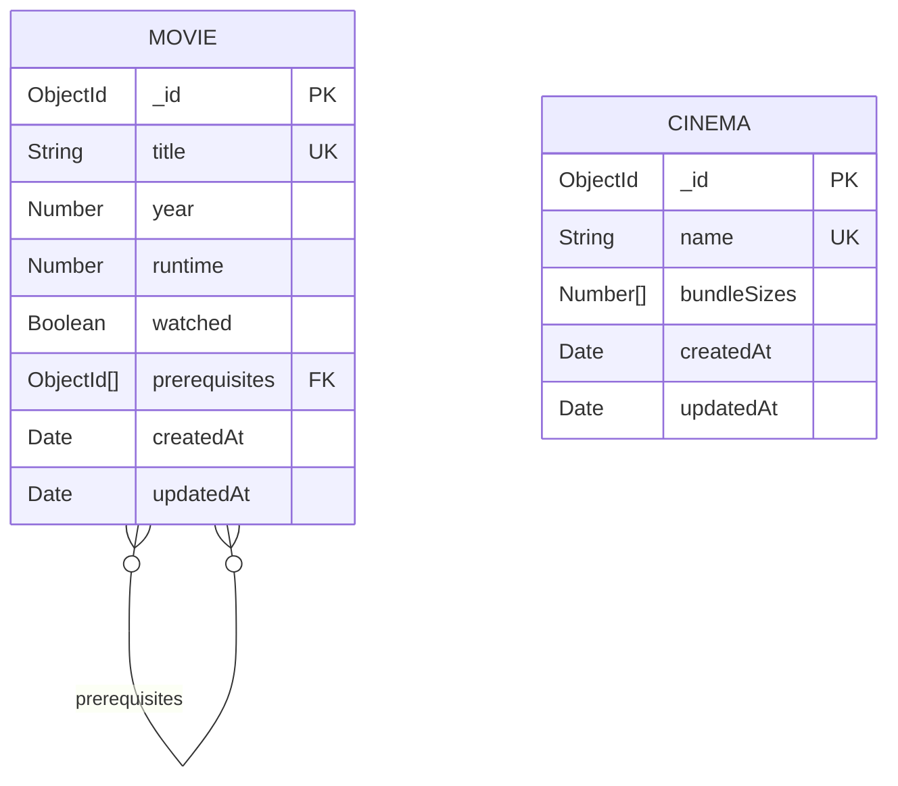

# Doomsday Ready

Doomsday Ready is a small full-stack application for MCU fans preparing for *Avengers: Doomsday*. It helps users manage movies and their prerequisite relationships, generate a rewatch plan, and calculate how a group can be accommodated when a cinema sells seats only in fixed-size bundles.

## Features

- **Movie library:** View movies, add new movies, edit movie details, manage prerequisites, and mark movies as watched.
- **Rewatch plan:** Select a target movie to see every prerequisite movie in a valid viewing order. The plan also shows the total number of prerequisite movies, how many are marked watched, and the remaining runtime.
- **Cinema booking calculator:** Select a cinema and enter a group size. The app finds a combination of available seat bundles that fills the group size exactly while using the fewest bundles. It reports when an exact combination is not possible.

## Technology

| Part | Technologies |
|---|---|
| Frontend | React 18, Vite, CSS |
| Backend | Node.js, Express |
| Database | MongoDB, Mongoose |
| Tests | Node.js built-in test runner (`node:test`) |
| Containerization | Docker, Docker Compose |

The two algorithm service files (`server/src/services/rewatch.js` and `server/src/services/booking.js`) contain plain JavaScript logic. They do not use a package that performs the cycle detection, graph traversal, or minimum-bundle calculation.

## Getting started

### Option 1: Docker Compose

You need Docker and Docker Compose installed.

From the project root, run:

```bash
docker compose up --build
```

Then open:

- Frontend: <http://localhost:3000>
- API: <http://localhost:5000/api>

Docker Compose starts MongoDB, the API, and the frontend. The API is configured to load the sample data when the database has no movies (`SEED_ON_EMPTY=true`). MongoDB data is stored in the `mongo-data` Docker volume.

To stop the services:

```bash
docker compose down
```

To stop the services and remove the persisted database volume as well:

```bash
docker compose down -v
```

### Option 2: Run locally

You need **Node.js 20 or later** and a MongoDB instance.

1. Start MongoDB locally.
2. In a terminal, install and start the backend:

```bash
cd server
npm install
npm run seed
npm run dev
```

The API runs on <http://localhost:5000> by default. `npm run seed` clears the existing movie and cinema collections before inserting the sample data, so do not run it if you want to keep the current data.

3. In a second terminal, install and start the frontend:

```bash
cd client
npm install
npm run dev
```

Open the Vite development URL shown in the terminal (normally <http://localhost:5173>). The Vite configuration proxies `/api` requests to the backend on port 5000.

The backend supports these environment variables:

| Variable | Default | Purpose |
|---|---|---|
| `PORT` | `5000` | Port used by the API server |
| `MONGO_URI` | `mongodb://127.0.0.1:27017/doomsday-ready` | MongoDB connection string |
| `SEED_ON_EMPTY` | unset / disabled | Set to `true` to load sample data at startup when the movie collection is empty |

## Data model

The application stores movies and cinemas in separate MongoDB collections. Movies reference other movies through their `prerequisites` field. This creates a directed dependency graph: an edge from Movie A to Movie B means Movie B must be watched before Movie A.



### Movie

- `_id`: MongoDB document identifier.
- `title`: required, trimmed, unique movie title.
- `year`: required release year; application validation accepts whole numbers from 1888 through 2100.
- `runtime`: required runtime in minutes; application validation accepts whole numbers from 1 through 300.
- `watched`: whether the user has watched the movie; defaults to `false`.
- `prerequisites`: an array of references to other Movie documents.
- `createdAt` and `updatedAt`: timestamps added by Mongoose.

### Cinema

- `_id`: MongoDB document identifier.
- `name`: required, trimmed, unique cinema name.
- `bundleSizes`: available seat-bundle sizes. Application validation requires a non-empty array of whole numbers from 1 through 500, removes duplicate sizes, and allows at most 10 distinct sizes.
- `createdAt` and `updatedAt`: timestamps added by Mongoose.

Movies and cinemas do not have a direct relationship in the current implementation. A movie's prerequisite references point to other movies, not to cinemas.

## Main algorithms

The core calculations are implemented in plain JavaScript in `server/src/services/` and are tested independently of Express and MongoDB.

### 1. Circular prerequisite detection

**Implementation:** `server/src/services/rewatch.js` — `wouldCreateCycle(movieId, newPrereqs, graph)`

When a movie's prerequisite list is changed, the API checks whether the proposed links would make that movie depend on itself, either directly or through a chain of other movies.

The function uses an iterative depth-first search (DFS):

1. Put the proposed prerequisite IDs on a stack.
2. Remove one ID at a time from the stack.
3. If the ID is the movie being edited, a cycle has been found.
4. If the ID has already been visited, skip it; otherwise mark it visited and add its prerequisites to the stack.
5. If the stack becomes empty without reaching the edited movie, the proposed change does not create a cycle.

A `Set` prevents unnecessary repeated visits. The explicit stack avoids relying on JavaScript's recursive call stack. The check uses the proposed prerequisite list and the current dependency graph. The API rejects a detected cycle with HTTP `409` and error code `CIRCULAR_DEPENDENCY`.

### 2. Rewatch order

**Implementation:** `server/src/services/rewatch.js` — `rewatchOrder(targetId, graph)`

The goal is to list every movie required before the selected target, with each prerequisite appearing before the movie that depends on it. The target movie itself is not included.

The function performs an iterative depth-first traversal in post-order:

1. Start at the target movie and mark it as visited.
2. Follow each prerequisite that has not already been visited, keeping track of the next prerequisite to process for each stack entry.
3. Add a movie to the result only after all of its prerequisites have been processed.
4. Remove the target movie from the end of the result before returning the prerequisite list.

The visited `Set` ensures that a movie shared by multiple dependency paths appears only once. Post-order processing ensures prerequisites appear before the movies that require them.

The API uses this order to calculate `total`, `watchedCount`, and `remainingMinutes`. Remaining time is the sum of runtimes for prerequisite movies whose `watched` value is `false`.

### 3. Minimum cinema bundle calculation

**Implementation:** `server/src/services/booking.js` — `bookingQuote(bundleSizes, groupSize)`

This function finds the minimum number of available bundles whose seat counts add up to the requested group size exactly. It returns `null` if no exact combination exists.

It uses dynamic programming rather than a greedy strategy:

1. Create an array where each position represents a seat total from `0` to `groupSize`.
2. Store the fewest bundles needed to reach each total. The starting value for zero seats is zero bundles; other totals initially have no known solution.
3. For each total, try every available bundle size that does not exceed that total. Keep the option that uses the fewest bundles.
4. Store the last bundle size used to reach each total.
5. If the requested total has no solution, return `null`. Otherwise, follow the stored bundle choices backwards to count the required bundles.

The result contains `totalBundles` and a `bundles` array with each bundle's `size` and `count`, sorted from largest size to smallest. For the same minimum number of bundles, the implementation returns one optimal combination; it does not try to list every tied combination.

## API reference

All routes are prefixed with `/api`. Request and response bodies use JSON.

| Method | Endpoint | Description |
|---|---|---|
| `POST` | `/api/movies` | Create one movie or an array of movies |
| `GET` | `/api/movies` | List movies, sorted by year and title |
| `PATCH` | `/api/movies/:id` | Update a movie's supplied fields, including watched status or prerequisites |
| `GET` | `/api/movies/:id/rewatch-order` | Get the ordered prerequisite list and progress totals for a target movie |
| `POST` | `/api/cinemas` | Create one cinema or an array of cinemas |
| `GET` | `/api/cinemas` | List cinemas, sorted by name |
| `GET` | `/api/cinemas/:id/booking?groupSize=6` | Calculate the minimum exact bundle combination for a group size |

### Example requests

Create a movie:

```http
POST /api/movies
Content-Type: application/json

{
  "title": "Example Movie",
  "year": 2025,
  "runtime": 120,
  "watched": false,
  "prerequisites": []
}
```

Update a movie's prerequisites (the array replaces the existing prerequisite list):

```http
PATCH /api/movies/MOVIE_ID
Content-Type: application/json

{
  "prerequisites": ["AN_EXISTING_MOVIE_ID"]
}
```

Get a booking quote:

```http
GET /api/cinemas/CINEMA_ID/booking?groupSize=44
```

Prerequisites can be supplied as existing movie IDs or exact movie titles. For array creation, movies are processed in the supplied order, so a movie can refer to a prerequisite created earlier in that same array.

### Error responses

Errors use this JSON shape:

```json
{
  "error": "ERROR_CODE",
  "message": "A human-readable explanation."
}
```

| HTTP status | Error code | Meaning |
|---|---|---|
| `400` | `VALIDATION_ERROR` | A request field is missing or invalid |
| `404` | `NOT_FOUND` | The requested movie or cinema does not exist |
| `404` | `PREREQUISITE_NOT_FOUND` | A referenced prerequisite movie does not exist |
| `409` | `CIRCULAR_DEPENDENCY` | The proposed prerequisite change creates a cycle |
| `409` | `DUPLICATE` | A movie or cinema with that unique title/name already exists |

## Tests

Run the backend tests from the `server` directory:

```bash
npm test
```

The tests use Node.js's built-in test runner and exercise the service functions directly, without requiring a running database. They cover rewatch ordering, shared prerequisites, direct and indirect cycle detection, booking examples, impossible booking totals, and the maximum supported group size.

## Assumptions and scope decisions

The brief does not specify every validation rule or behavior, so the implementation makes these choices:

- Movie titles and cinema names are required, trimmed, and unique.
- Movie release years must be whole numbers from 1888 through 2100.
- Movie runtimes must be whole numbers from 1 through 300 minutes.
- Cinema bundle sizes must be whole numbers from 1 through 500. A cinema must have at least one bundle size and can have no more than 10 distinct sizes.
- Repeated bundle sizes are silently removed before saving.
- A group size must be a whole number from 1 through 10,000.
- Prerequisites can be identified by an existing movie ID or exact title. A missing prerequisite produces `PREREQUISITE_NOT_FOUND`.
- When an array of movies or cinemas is posted, items are processed in order and processing stops at the first error. Earlier successful items are not rolled back.
- A newly created movie cannot already be referenced by another movie in the normal create flow, so the circular-dependency check is applied when prerequisites are updated.
- Updating `prerequisites` replaces the entire list rather than appending to it.
- If multiple bundle combinations use the same minimum number of bundles, the API returns one of those combinations.
- The current application does not include user authentication, movie/cinema deletion, booking persistence, or payment processing; these were kept outside the implemented scope.

## Project structure

```text
doomsday-ready/
├── client/
│   └── src/
│       ├── views/
│       │   ├── Movies.jsx
│       │   ├── Rewatch.jsx
│       │   └── Booking.jsx
│       ├── App.jsx
│       ├── api.js
│       └── styles.css
├── server/
│   ├── src/
│   │   ├── models/
│   │   │   ├── Movie.js
│   │   │   └── Cinema.js
│   │   ├── routes/
│   │   │   ├── movies.js
│   │   │   └── cinemas.js
│   │   ├── services/
│   │   │   ├── rewatch.js
│   │   │   └── booking.js
│   │   ├── validation.js
│   │   ├── seed.js
│   │   └── index.js
│   └── test/
│       └── services.test.js
├── docker-compose.yml
└── README.md
```

## AI assistance disclosure

AI assistance was used during development, including assistance with implementation and documentation. The core algorithm files are `server/src/services/rewatch.js` and `server/src/services/booking.js`. 
